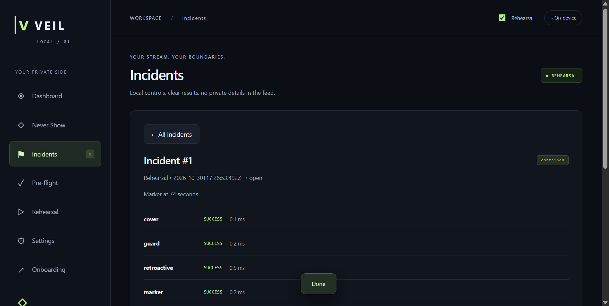
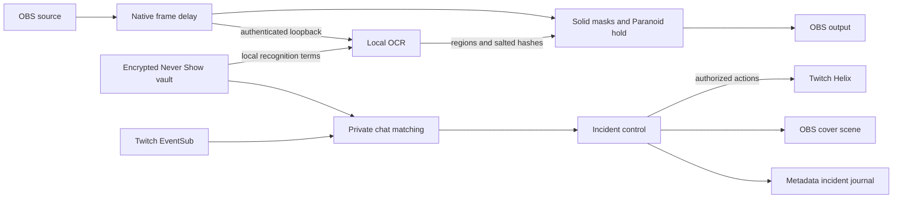

# VEIL — Stream with boundaries.

**Keep your private life off-stream.** VEIL brings local screen masking, a private **Never Show** vault, and Twitch incident control into one OBS workflow.

[](https://github.com/vivekyarra/veil/actions/workflows/ci.yml)
[](https://github.com/vivekyarra/veil/releases)
[](#built-with-codex)

[**Download VEIL**](https://github.com/vivekyarra/veil/releases) · [**Get started**](#get-started) · [**See the proof**](#proof-you-can-inspect) · [**Build from source**](#build-from-source)


## One wrong window. One very public moment.

A streamer opens an inbox, a private message, or a terminal. An address or credential appears. Chat can repeat it before the streamer has time to react.

VEIL puts protection and response in the same control room: check the setup, mask sensitive screen text, match private terms in chat, and switch to a cover scene when it matters.

## Protect. Detect. Respond.

| Moment | What you do | What VEIL brings together |
|---|---|---|
| **Before you go live** | Connect OBS and Twitch. Add your Never Show terms. Run Pre-flight. | Source previews, local text checks, capture settings, and audio alignment. |
| **While you stream** | Keep your screen workflow. | Local OCR, solid masks in a native OBS filter, and private Twitch chat matching. |
| **When you need control** | Press **Panic**. Review the incident. | A cover scene, session terms, a VOD marker, recent-chat review, and approval controls for additional actions. |

**Your terms stay yours.** The encrypted Never Show vault feeds local matching. Adding a private term does not add it to Twitch's shared blocked-term list. Sharing a term is a separate, explicit action.

One private Never Show list drives both screen checks and Twitch chat matching. Panic brings the response into the same workflow.

**Protection happens in OBS.** The native filter works on delayed source frames. Paranoid is the default: output stays covered until checks complete. Pre-flight helps you choose a delay that fits your machine.

**Practice before going live.** Rehearsal runs the local OCR pipeline on practice captures and keeps account actions isolated. You can check your response without changing your broadcast.



## Built into the tools streamers use

- **OBS:** native source filter, scene control, configurable delay, and audio-offset recovery.
- **Twitch:** device sign-in, EventSub chat events, Helix moderation, broadcast markers, Shield Mode approval, and clip review.
- **Your computer:** RapidOCR and ONNX Runtime process screen text locally. No cloud inference or telemetry.
- **Your decisions:** approval dialogs keep sharing private terms and enabling additional account actions under your control.

## Proof you can inspect

| Evidence | Result |
|---|---|
| **3,000-screen controlled benchmark** | Card recall **99.77%**; email **99.77%**; secrets **99.30%**; vault **100%**; phone **99.77%**; address **99.77%**. Negative-screen false-positive rate **0.47%**. [Scoring and source](docs/benchmark.md). |
| **Real Twitch broadcast** | OAuth and EventSub connected; a 720p broadcast, Panic cover switch, and a VOD marker at **111 seconds** were verified. [Recorded checks](docs/live-twitch-smoke.json). |
| **Native OBS output** | Windows filter loaded in OBS 31.1.1; pixel checks verified solid masks, surrounding pixels, and Paranoid hold behavior. [Native checks](docs/native-obs-smoke.json). |
| **Windows and macOS packages** | Packaged app checks exercise onboarding, local OCR, vault, incident export, and clean audio rollback. [CI](https://github.com/vivekyarra/veil/actions/workflows/ci.yml). |
| **Automated quality checks** | **280 Python tests**, **247 app tests**, shared matcher cases, native CTest, and accessibility checks across seven pages in both themes. [Verification](docs/acceptance.md). |

## Get started

1. **[Download VEIL and the matching OBS plugin](https://github.com/vivekyarra/veil/releases).** Desktop builds are available for Windows x64 and Mac Apple Silicon. The macOS OBS plugin supports Apple Silicon and Intel. Current downloads are unsigned; checksums accompany each release.
2. **Install the plugin** and restart OBS. [Windows and macOS instructions](plugin/README.md).
3. **Connect OBS** in VEIL Onboarding using its local WebSocket address and password. Select your scenes and apply the filter settings.
4. **Sign in with Twitch.** The public VEIL Stream Guard app is configured for you. Authorize your account in the browser; no Client Secret is needed.
5. **Set your boundaries.** Add a practice Never Show term, run Rehearsal and Pre-flight, then inspect the OBS output before going live. If Pre-flight offers **Apply measured delay**, use it to update the filter and audio together and rerun the checks.

VEIL saves audio offsets before applying changes and restores them on clean exit or the next OBS connection after a crash. [Operating details and measured timing](docs/acceptance.md) · [Security and privacy](SECURITY.md).

**Try the response loop:** open **Rehearsal → Email inbox** to inspect detected regions and timing. Press **Panic** to review a practice incident and its approval controls. When your OBS and Twitch setup is ready, turn off the top-bar **Rehearsal** switch to enable connected account actions.

## How it works



The Electron and React control room coordinates the native OBS plugin, local Python detector, and Twitch connection. The vault uses AES-256-GCM with an OS-protected key. Default incident reports leave out recognized private text. [Component and license map](docs/architecture.md).

## Built with Codex

VEIL was built in one primary Codex chat, from the native OBS filter to the desktop app and Twitch integration. Codex helped implement and verify the hard connections: frame deadlines, numeric OCR recovery, Unicode chat matching, account authorization, audio rollback, and packaged app tests on both platforms.

**Main build chat:** `01a187d8-7c89-7993-bb7c-340d3f64dc8f` · [Recorded provenance](docs/build-provenance.json).

## Build from source

Requires **Node.js 24**, **uv / Python 3.11**, Git, and OBS. Native builds need Visual Studio 2022 C++ tools, Windows SDK and CMake on Windows, or Xcode tools on macOS.

```powershell
./scripts/setup.ps1
./scripts/dev.ps1
./scripts/build-plugin.ps1
./scripts/package.ps1
```

Use the matching `.sh` scripts on macOS. [Development and verification commands](docs/development.md).

| Directory | Purpose |
|---|---|
| `app/` | Electron / React control room and Twitch integration |
| `plugin/` | Native OBS filter and frame policy |
| `detector/` | Local OCR, recognizers, tracking, and authenticated service |
| `bench/` | Reproducible screenshot corpus and scoring |
| `shared/` | Cross-language normalization cases |

Desktop and detector: **MIT**. OBS-linked plugin: **GPL-2.0-or-later**. RapidOCR, ONNX Runtime, and official OBS plugin scaffolding retain their upstream notices. [Licenses and acknowledgements](docs/architecture.md#licenses-and-acknowledgements).
