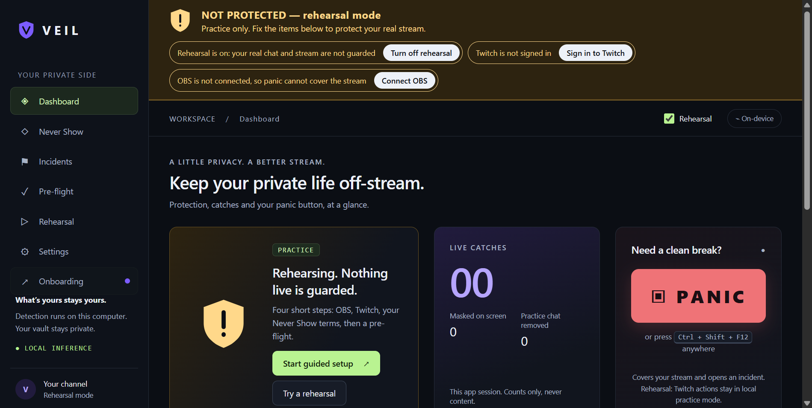
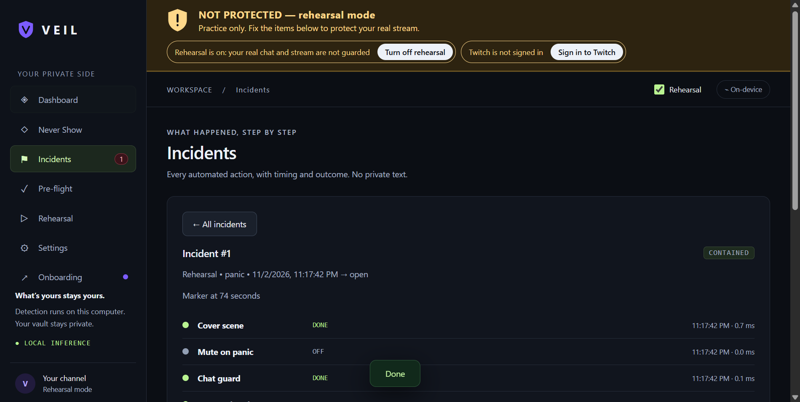
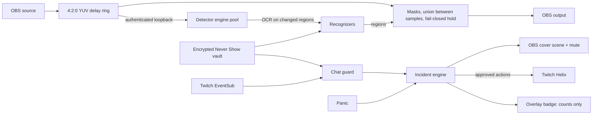

# VEIL

**Private info never reaches your stream — or your chat.**

[](https://github.com/vivekyarra/veil/actions/workflows/ci.yml)
[](https://github.com/vivekyarra/veil/releases)
[](#built-with-codex)



<!-- TODO: replace with the final demo video URL -->
[▶ Watch the 3-minute demo](https://youtu.be/)

## Judge quick start

No OBS or Twitch account needed:

1. Download the Windows x64 or macOS installer from [GitHub Releases](https://github.com/vivekyarra/veil/releases) and open VEIL. Onboarding starts in **Rehearsal**, with a banner showing that you are practicing.
2. Open **Rehearsal → Email inbox** and watch local OCR find the private text and mask it.
3. Add a term to **Never Show**, then press **Send practice chat attempts**. Practice viewers try to repeat it with leetspeak, lookalike letters and split messages, and the chat guard catches them.
4. Press **Panic** (or `Ctrl+Shift+F12`; `Cmd+Shift+F12` on macOS). The stream is covered and an incident opens.
5. Open **Incidents** to review what happened and the approval controls. Practice actions never touch your Twitch account.

## What it does

- **Screen:** a native OBS filter masks private text locally before frames leave the PC: cards, emails, phones, addresses, IPs, IBANs, national IDs, secrets and anything in your encrypted **Never Show** vault. In Paranoid mode (the default), a frame that has not been checked stays covered.
- **Chat:** a Twitch chat guard deletes repeats through EventSub and Helix, catching lookalike letters, leetspeak and messages split across lines. Vault terms stay on your machine.
- **Panic:** one key covers OBS with a cover scene, drops a VOD marker and sweeps recent chat. Mic mute is one setting away, and Shield Mode turns on with a single approval.
- **Community:** moderator mode lets a trusted mod run VEIL for the streamer, and an on-stream overlay badge counts catches without ever showing what it caught.



## How it works



An Electron and React control room coordinates three local parts: the native OBS filter (C/C++), a Python detector (RapidOCR on ONNX Runtime) and the Twitch connection. Pixels and OCR text stay on the machine; only Twitch actions you authorize leave it. [Architecture](docs/architecture.md) · [Security and privacy](SECURITY.md)

## Built with Codex

VEIL was built with OpenAI Codex. The main build session is `01a187d8-7c89-7993-bb7c-340d3f64dc8f` ([provenance](docs/evidence/build-provenance.json)). In that session Codex built the system end to end, from the native OBS filter to the desktop app and the Twitch integration:

- **Native OBS filter:** delayed frames, frame deadlines and fail-closed Paranoid holds, with native pixel checks in real OBS.
- **Local OCR detector:** RapidOCR on ONNX Runtime, numeric recovery for card digits, and an authenticated loopback service.
- **Unicode chat matching:** one normalizer shared across TypeScript and Python through one case file ([shared/normalization-cases.json](shared/normalization-cases.json)).
- **Twitch:** device sign-in with no client secret, EventSub chat with subscription acknowledgement, Helix moderation, and VOD markers.
- **Verification:** audio-offset rollback, and packaged-app tests on Windows and macOS.

Today the project runs over 1,000 automated tests (TypeScript, Python and native C) in CI on every push.

## Build from source

Requires **Node.js 24**, **uv / Python 3.11**, Git and OBS. Native builds need Visual Studio 2022 C++ tools, the Windows SDK and CMake, or Xcode tools on macOS.

```powershell
./scripts/setup.ps1
./scripts/dev.ps1
./scripts/build-plugin.ps1
./scripts/package.ps1
```

Use the matching `.sh` scripts on macOS. To go live, install the [OBS plugin](plugin/README.md), connect OBS WebSocket in onboarding, sign in with Twitch, run **Pre-flight** and apply the measured delay. [Development guide](docs/development.md)

| Directory | Purpose |
|---|---|
| `app/` | Electron / React control room, chat guard, incidents, overlay |
| `plugin/` | Native OBS filter, delay ring and frame policy |
| `detector/` | Local OCR engine pool, recognizers and change detection |
| `bench/` | Generated test corpus and scoring |
| `shared/` | Cross-language normalization cases |

## Tests & benchmarks

Over 1,000 automated tests run in CI on every push, and recognition is scored on a generated test corpus with known ground truth: [benchmark](docs/benchmark.md) · [temporal benchmark](docs/benchmark-temporal.md) · [verification guide](docs/acceptance.md).

## What's next

- GPU OCR to shorten the delay on busy scenes.
- Audio awareness, so a secret read aloud can be bleeped.
- Signed installers and a one-click OBS plugin install.
- Pilots with streamers and moderation teams to tune defaults on real setups.

## License

Desktop and detector: **MIT** ([LICENSE](LICENSE)). OBS-linked plugin: **GPL-2.0-or-later** ([plugin/LICENSE.md](plugin/LICENSE.md)). [Acknowledgements](docs/architecture.md#licenses-and-acknowledgements)
