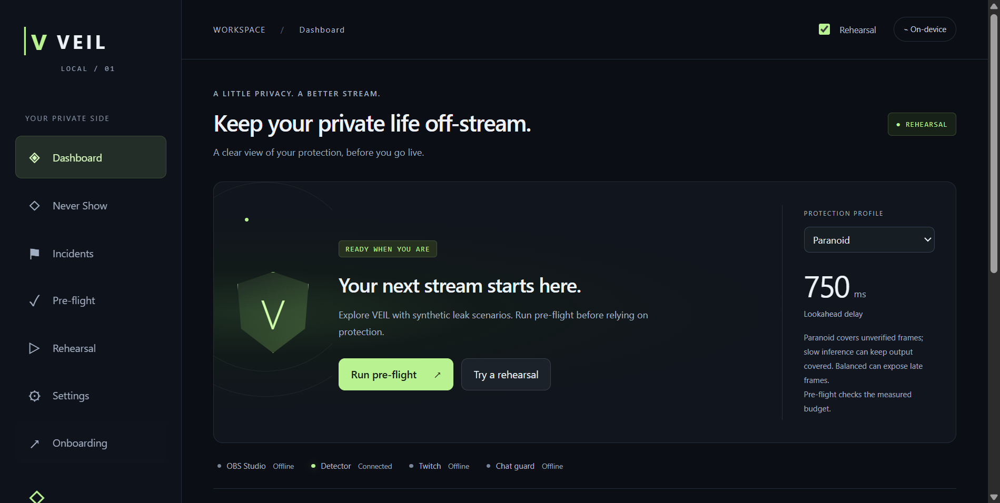
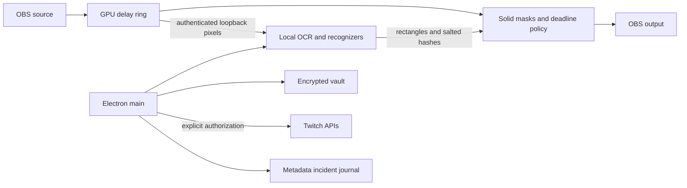

# VEIL

Local OBS screen masking, private Twitch chat matching, and incident response. **Version 0.2 defaults to Paranoid: unverified frames stay covered, including detector stalls. Slow inference can keep output covered.**



## Measured status

The completed 3,000-screen synthetic benchmark measured recall: email 99.77%, card **99.77%**, secret 99.30%, vault 100%, phone 99.77%, address 99.77%. Negative-screen FPR was 0.47%. **All unchanged recall/FPR gates pass.** Two concurrent CPU workers measured p50 1.35 s and p99 2.09 s, excluding queue wait. These controlled layouts do not establish real-world recall or safe default-delay streaming. [Full reproducible evidence](docs/benchmark.md). The earlier failing baseline remains in [benchmark-full.md](docs/benchmark-full.md).

The Windows DLL loaded in real OBS 31.1.1 and passed synthetic solid-mask, outside-pixel preservation and Paranoid unavailable-detector checks. This short smoke does not prove sustained 1080p60 performance. [Native evidence](docs/native-obs-smoke.json). Real Electron onboarding, vault, panic, source review, actual OCR rehearsal, PDF export and clean audio rollback pass against local contracts. [All seven CI jobs passed](https://github.com/vivekyarra/veil/actions/runs/40989155161), including Windows/macOS native packages and packaged Windows E2E. Live Twitch OAuth and EventSub connected on the authorized test channel. Reference GPU, sustained rendering and clean-machine setup remain unverified. [Acceptance ledger](docs/acceptance.md).

## Windows installation

Local unsigned development installers are generated in `app/release/`; binaries are not committed.

Platform builds and packaged Windows E2E run in [GitHub Actions](https://github.com/vivekyarra/veil/actions). Download the versioned Windows installer or macOS DMG and matching native plugin artifact from a successful run. See [platform plugin installation](plugin/README.md). These unsigned builds require manual installation; do not interpret CI as a real streaming-PC performance guarantee.

1. Install OBS with obs-websocket v5 enabled and a password. Use its local WebSocket address.
2. Copy `plugin/dist/veil-guard.dll` into OBS's `obs-plugins/64bit/`. Copy `plugin/data/locale/` into `data/obs-plugins/veil-guard/locale/`. Restart OBS.
3. Start VEIL, open Onboarding, connect OBS and select scenes. Apply the filter/delay configuration. The app supplies the authenticated local detector token file to the filter.
4. Add synthetic Never Show terms and run Pre-flight and Rehearsal. Inspect actual OBS output before streaming. Balanced can expose late results; Paranoid covers late/unavailable results. A passing configuration check does not override measured latency.
5. For live account features register a **Public** Twitch application, enter its public Client ID in VEIL's Onboarding page, then start device authorization. No Client Secret is requested. `TWITCH_CLIENT_ID` or the repository's `.env` is also supported for development. Offline rehearsal does not need Twitch credentials.

Audio offsets are saved before changing them and restored at clean exit or next OBS connection after a crash. Avoid independently changing offsets while VEIL owns them.

### Source development

Requires Node.js 24, uv/Python 3.11, Git and OBS. Native Windows builds require Visual Studio C++ tools, Windows SDK and CMake; macOS requires Xcode tools. The official plugin template downloads pinned SDK dependencies.

```powershell
./scripts/setup.ps1
./scripts/dev.ps1
./scripts/build-plugin.ps1
./scripts/package.ps1
```

macOS equivalents are the `.sh` scripts. macOS packaging is configured but unexecuted on this Windows host. Grant operating-system capture/window permissions. X11 enumeration is best effort; Wayland window enumeration is unavailable.

```powershell
uv run --project detector ruff check detector
uv run --project detector mypy --config-file detector/pyproject.toml detector/veil_detector
uv run --project detector pytest detector/tests --cov=veil_detector --cov-fail-under=85
npm.cmd run lint --prefix app
npm.cmd run test:coverage --prefix app
npm.cmd run build --prefix app
npm.cmd run test:e2e --prefix app
```

Generate actual screenshots with `uv run --project detector python bench/generate.py`. See `bench/evaluate.py --help` for scoring. Full CPU inference is expensive; evidence is cached by exact source, models, corpus and worker settings.

## Architecture and privacy



No cloud inference or telemetry. Pixels and OCR text remain in local process memory. The IPv4-loopback detector requires a random per-install bearer token and disables access logs. The renderer is sandboxed with context isolation and narrow IPC. Vault AES-256-GCM keys are wrapped by Electron safeStorage; unavailable encryption fails closed. PIN reveal is temporary and rate limited.

Default reports/events omit recognized text. Explicitly enabled blocked terms send selected private terms to Twitch, where moderators may see them. Optional Discord sends incident metadata to the configured webhook. Chat text is held in a bounded in-memory ring for retrospective deletion. See [security guidance](SECURITY.md).

## Limitations and prior art

OCR can miss small, blurred, occluded or unusual text. The synthetic corpus uses controlled layouts. Camera/IRL and spoken audio leaks are outside scope. Window protection depends on permissions and capture coordinates. Changed frames currently use whole-frame OCR rather than cropped tiles. CPU latency exceeds the configurable delay; the Intel Iris Xe DirectML probe timed out. Shipping inference uses CPU ONNX. Reference-GPU acceptance is open.

Moderation is reactive: messages can be briefly visible before deletion. Twitch permissions and protected users limit actions. Clip listing is for human review; VEIL does not automatically delete clips or VODs. Rehearsal is a simulation and does not prove native live-stream timing.

Related work includes [obs-pii-redactor](https://github.com/georgebreen/obs-pii-redactor), ScreenLeak and browser redaction extensions such as Entropy. VEIL explores combining lookahead masking, private chat matching and incident response. The [Screenpipe image redactor](https://huggingface.co/screenpipe/pii-image-redactor) has a noncommercial license and is not included. RapidOCR/ONNX Runtime provide OCR; plugin scaffolding derives from official obs-plugintemplate. [Attribution and decisions](DECISIONS.md). Desktop/detector source is MIT; the OBS-linked plugin is GPL-2.0-or-later with upstream notices retained.

## Maintainers

Before public protection claims: pass the card gate, validate GPU latency/sustained output, execute platform CI and test clean Windows onboarding within five minutes. A human must register Twitch, authorize a test account and verify deletions, markers, Shield Mode and clips on a real test stream. Record the [demo](docs/demo-script.md), review the [submission draft](docs/devpost-submission.md), verify official event rules/deadline, publish the repository and submit manually. No public push or submission has been performed.
